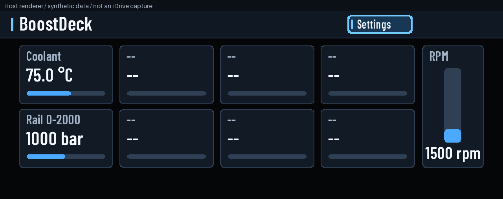

# BoostDeck diesel rail display range

BoostDeck previously used its gasoline 0–250 bar rail-pressure display range in
both engine profiles. A synthetic standard PID `23` response `41 23 27 10`
decodes to 1,000 bar, but the bar and circular dial were already full at 250 bar.
The numeric reading was correct; the graphic could not distinguish higher values.

Select **BoostDeck settings → Diesel rail display scale** to choose a 0–1,000,
0–1,600, 0–2,000 or 0–2,500 bar scale. The default is 0–2,000 bar. These are
application display choices, not BMW specifications, ECU identification, pressure
targets, safe operating limits or a claim that the selected vehicle supports rail
telemetry. Select Diesel in the existing Engine profile menu to use this scale.

The rail tile caption shows the selected range in the same units as the reading
below it. Pressure-unit changes convert the caption and settings choices between
bar, psi and kPa without changing the fill fraction. Horizontal bars, circular
dials and the narrow ninth tile all use the same scale. At 1,000 bar on the default
scale the graphic is half full. Values beyond the chosen range fill the graphic
and retain their full numeric value. Unavailable or stale readings remain `--`.
The gasoline profile retains its existing 250-bar range and captions; other
signals retain their current ranges in both profiles.

## Saved settings and rollback

The scale uses a separate three-byte, versioned `R1` file:
`/var/opt/hmi/data/ID5/BoostDeck.rail-scale`. Missing, malformed, unsupported-version
or out-of-range files leave the default choice. Saves use the existing atomic
temporary-file/rename helper; a failed save reports an error and retains the
previous choice. The older `G1`/`G2` `BoostDeck.prefs` and `B1`/`B2`
`BoostDeck.signals` readers and writers are unchanged. Changing the scale writes
neither of those files and does not restart a collector or send diagnostics.

An older BoostDeck binary ignores the separate scale file and can still read the
ordinary preferences and gauge assignments. Restore the complete previous app
folder, including its matching XML and image archive, for rollback. Preserve the
preferences and scale file with the backup. This change does not authorize an
installation or restart on a vehicle.

## Reproduce offline checks

```sh
make -C source/native test
python3 -m venv /tmp/idrive-boost-scale-env
/tmp/idrive-boost-scale-env/bin/pip install Pillow==13.0.0
/tmp/idrive-boost-scale-env/bin/python -B source/tools/test_boost_scale_resources.py
```

The two scale tests exercise production PID decoding, every display choice,
invalid numeric input and persistence, unchanged gasoline/other-signal ranges,
actual plugin callbacks, horizontal/vertical/dial image selection, unit changes,
stale/unsupported blanks, profile switching, restart and save failures. The plugin
test uses a host BMW framework stand-in from Andreas Boehm's MIT-licensed
[PR #143](https://github.com/inotbarnacle/iDriveDeck/pull/143); it never displays
the live dashboard or launches a diagnostic worker. Resource tests check the
generated menu, model/action IDs, original dashboard geometry and initial image
IDs, plus all 906 regenerated image dimensions/pixels against the package. PNG
compression bytes may vary with Pillow. The image-generation algorithm and raster assets are unchanged; the new
control is native text. Run `make -C source/native assets` to stage matching assets
when preparing a source build; generated native outputs remain private/ignored.

CI runs GCC/Clang host regressions, C++98 plugin syntax, Clang static analysis and
AddressSanitizer/UndefinedBehaviorSanitizer for both new tests. These are synthetic
host checks. They do not establish QNX ABI/loader compatibility, actual HMI text
wrapping, DDE support or an N57/X5 rail-pressure measurement. No request, response
format, scaling, validity rule, worker packet, firmware profile or vehicle setting
is changed by this display feature.

## Full-screen BoostDeck

The full-screen view offers the same four ranges in **Settings → Diesel rail
display scale**. The choice applies to the existing rail-pressure signal in
custom and detected layouts, including the narrow ninth tile, bars and dials.
Range captions follow pressure units. A valid 1,000-bar reading fills half of
the default 2,000-bar graphic; its numeric value remains 1,000 bar. Gasoline and
all other signals retain their existing ranges.

Full-screen keeps its own `ID6LibraryLab.boost.rail-scale` R1 file under the
existing HMI data directory. An absent or invalid file leaves the 2,000-bar app
default; the standard app's separate R1 choice is not imported. Loads do not
rewrite files. The range action changes only this record, refreshes cached
readings/captions and leaves a running worker intact. Normal page-focus lifecycle
still applies. A failed save retains the prior choice and shows a persistent
warning. Existing preferences, layouts and detected/custom mode keep their bytes.
The emulator validates and preserves R1 alongside G/B/D records in its own files.

Surface **v7 (`ID6Y`), 496 bytes** carries the range and units explicitly. Boost
uses `shift_target` for the maximum in bar (zero for gasoline) and `launch_mode`
for pressure units. Tach animation owns `tach_visual` and cannot alter those
fields. Versions 1–6 are rejected. Rebuild the complete matching full-screen
bundle, including renderer, plugins, workers, optional companions and emulator
parts; preserve the entire previous bundle and settings for rollback. This
source builds on [fork telemetry #5](https://github.com/voioo/iDriveDeck/pull/5).

Host checks exercise production callbacks and local worker traffic, every range
and pressure unit, automatic/custom/ninth-slot layouts, zero/stale values,
failed saves and restart persistence. The actual C renderer and its animation
entry point are tested on five panels. Ninety gasoline renders match the preceding
renderer (`e5ffcf2`) across both styles and all nine colors. Recorded build inputs
also host-link the renderer's shared core dependency; omitting it fails the link.
Those adapted host links exclude QNX Screen/LayerManager and ARM-only flags and
do not constitute a QNX build. Focused Boost/Warm/Shift ASan/UBSan and C++98
syntax checks pass. Full-source CI, licensed QNX/ABI and parked validation remain
separate requirements; no vehicle result or native release payload is added.


